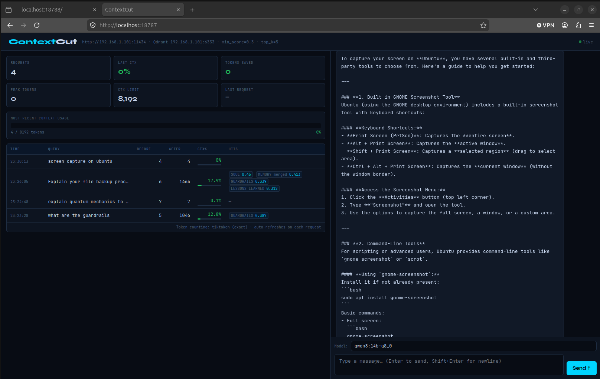
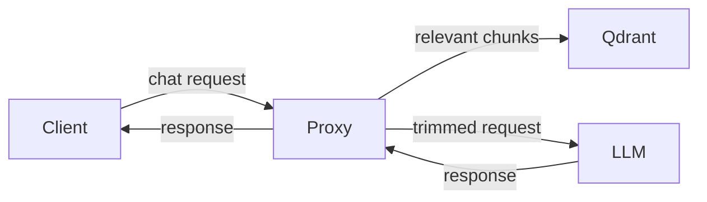

# ContextCut-PRO

**Stop wasting tokens. Inject only what matters.**

ContextCut-PRO is a transparent semantic RAG proxy that drops in front of any LLM — Ollama, OpenAI, OpenRouter, or any OpenAI-compatible endpoint. Zero application changes. It intercepts each request, finds the relevant chunks from your knowledge base, and injects only what scores above your threshold. If nothing is relevant, it injects nothing — saving you 50–90% on tokens.



*Split-panel dashboard: live token analytics, per-request breakdown, integrated streaming chat, model selector.*

---

## How it works



1. Your existing LLM client sends a request to ContextCut (port 18788)
2. ContextCut vector-searches your knowledge base in Qdrant
3. Only chunks scoring above `MIN_SCORE` are injected into the prompt
4. Request is forwarded to your LLM — response streams back through the dashboard

**Zero code changes.** Just point your client at `http://localhost:18788/v1/chat/completions` instead of your LLM.

---

## Token savings — real numbers

| Query | Without ContextCut | With ContextCut |
|---|---|---|
| "What are the guardrails?" | 3,000+ tokens (all docs) | 806 tokens (1 relevant chunk) |
| "Explain quantum physics" | 3,000+ tokens (junk) | ~5 tokens (nothing relevant — skipped) |

**50–90% reduction on real workloads.** The dashboard shows every request with before/after token counts and relevance scores.

---

## Features

| Feature | ContextCut-PRO |
|---|---|
| Transparent RAG proxy | ✅ Drop-in, zero code changes |
| Semantic search | ✅ Qdrant + Voyage AI or Ollama embeddings |
| Smart injection | ✅ Only injects when relevant (MIN_SCORE threshold) |
| Real-time dashboard | ✅ Split-panel: token analytics + streaming chat |
| Per-request breakdown | ✅ Before/after tokens, CTX%, relevance hits per query |
| Session history | ✅ SQLite persistence with searchable archive |
| File watcher | ✅ Auto-ingest `.md` files on change |
| Live context bar | ✅ Visual CTX% usage with real-time updates |
| Model selector | ✅ Quick-switch between Ollama / cloud models |
| Multi-provider | ✅ Ollama, OpenAI, OpenRouter, Custom |
| MCP Knowledge Server | ✅ Expose KB via Model Context Protocol |
| Embedding backend | ✅ Local (Ollama) or cloud (Voyage AI) |
| One-liner install | ✅ macOS launchd / Linux systemd + start.sh |
| Qdrant auto-install | ✅ Installed by installer if not found |

### Dashboard Controls

Six controls affect how the proxy responds:

| Control | Options | Description |
|---|---|---|
| **Scan ON/OFF** | Toggle button | Enables confidence scanning of responses. After each assistant reply, a secondary LLM evaluates factual claims and highlights suspect passages inline. When ON with Agent mode, enables automatic self-correction on LOW-confidence responses |
| **DEEP** | Checkbox | Uses sub-agent verifier harness with Qdrant KB search for evidence-backed fact-checking, instead of a single LLM pass. Requires Scan ON. Disables the self-correction loop |
| **🛡 TypeSafe** | Toggle button | Replaces the local scan LLM with the TypeSafe.ai cloud verifier. Requires `TYPESAFE_API_KEY`; only active with Scan ON. See [TypeSafe — Cloud Claim Verifier](#typesafe--cloud-claim-verifier-optional) |
| **Agent ON/OFF** | Toggle button | Enables tool-use mode — agent can run shell commands, read/write files, search the KB |
| **Unattended** | Checkbox | Auto-approves shell commands the agent wants to run, skipping the Allow/Deny prompt |
| **Model** | Text input | The model name to use (e.g. `qwen3:14b-q8_0`, `deepseek-v4-pro:cloud`) |

Agent ON and DEEP are independent — any combination works, from simple chat (both OFF) to verified agent (both ON).

---

## Alternatives comparison

| | ContextCut-PRO | Odysseus | OpenAI Assistants | DIY RAG |
|---|---|---|---|---|
| **What it is** | RAG proxy | Full AI workspace | Cloud RAG API | Manual implementation |
| **Setup time** | 30 seconds | ~5 minutes | Minutes | Days–weeks |
| **App changes** | None (proxy) | Replace your client | Replace your client | Full integration |
| **Privacy** | 100% local | Mostly local | Cloud-only | Depends on setup |
| **Token analytics** | Live dashboard | None | View via API | Build yourself |
| **Chat history** | SQLite + search | Built-in | Platform history | Build yourself |
| **Resource footprint** | 1 Python process | Multi-container (Chroma, SearXNG, ntfy, ...) | Nothing local | Varies |
| **Cost** | $99.88 one-time | Free (MIT) | Usage-based | Free |
| **Knowledge base** | Auto-ingest `.md` files | Manual upload | File upload API | Manual pipeline |

**ContextCut-PRO fits the niche between "free DIY" and "heavy workspace" — a single-purpose tool that does one thing well with zero friction.**

---

## Requirements

- Python 3.10+
- [Voyage AI API key](https://dash.voyageai.com) (free tier works) — or use local Ollama embeddings
- [Qdrant](https://qdrant.tech) (auto-installed by the installer if not found)
- Ollama or any OpenAI-compatible LLM endpoint
- Valid PRO license key (delivered via email at purchase)

---

## Install

### One-command (from purchase email)

```bash
curl -fsSL "https://api.contextcut-pro.com/install/CC-PRO-your-key-here" | bash
```

### Manual

```bash
curl -fsSL https://raw.githubusercontent.com/StevoKeano/ContextCut-PRO/main/install.sh -o /tmp/cc-install.sh
chmod +x /tmp/cc-install.sh
bash /tmp/cc-install.sh
```

On macOS, services start automatically on login (launchd). On Linux, a `start.sh` script is generated along with an optional systemd user service for reboot-proof operation.

---

## Quick start after install

```bash
# 1. Copy knowledge files
cp ~/contextcut/starterKnowledgeFiles/base-* ~/contextcut/knowledge/

# 2. Point your LLM client at the proxy
#    instead of http://localhost:11434/v1, use http://localhost:18788/v1

# 3. Open the dashboard
# macOS
open http://localhost:18787
# Linux
xdg-open http://localhost:18787
# Windows
start http://localhost:18787
```

See [Run and operate](#run-and-operate) for managed startup, MCP startup, auto-start, SSH tunnels, and troubleshooting.

---

## Run and operate

### Managed startup

```bash
cd ~/contextcut
./start.sh                # start proxy + watcher, wait for .proxy_ready, tail pro.log
./stop.sh                 # stop watcher, MCP (if .mcp.pid), then proxy
./stop.sh && ./start.sh   # restart after changing .env or Python files
```

`start.sh` writes `.proxy.pid` and `.ingest.pid`. `stop.sh` releases the license seat, stops the watcher, stops the MCP server if `.mcp.pid` exists, then stops the proxy. On Linux the managed start does **not** start the MCP server; start it separately. On macOS the installer's launchd agent starts it automatically.

Check status and logs:

```bash
cd ~/contextcut
for f in .proxy.pid .ingest.pid .mcp.pid; do
  [ -f "$f" ] && printf '%s: %s\n' "$f" "$(cat "$f")"
done
ss -lntp | grep -E ':(18787|18788|8910)\b' || true
tail -f pro.log
```

### Manual foreground startup

Run each process in its own terminal:

```bash
# Terminal 1 — proxy + dashboard
cd ~/contextcut
set -a; . ./.env; set +a
venv/bin/python qdrant_proxy_final.py
```

```bash
# Terminal 2 — knowledge-base watcher
cd ~/contextcut
set -a; . ./.env; set +a
venv/bin/python ingest.py --watch
```

```bash
# Terminal 3 — MCP knowledge server (HTTP)
cd ~/contextcut
set -a; . ./.env; set +a
venv/bin/python mcp_knowledge_server.py \
  --transport http --port "${CONTEXTCUT_MCP_PORT:-8910}"
```

To leave MCP running in the background and let `stop.sh` manage it:

```bash
cd ~/contextcut
set -a; . ./.env; set +a
nohup venv/bin/python mcp_knowledge_server.py \
  --transport http --port "${CONTEXTCUT_MCP_PORT:-8910}" \
  >> mcp.log 2>&1 &
echo $! > .mcp.pid
```

Test retrieval without starting the proxy:

```bash
cd ~/contextcut
venv/bin/python ingest.py --query "your test query"
```

### Auto-start

Linux systemd user service:

```ini
# ~/.config/systemd/user/contextcut.service
[Unit]
Description=ContextCut PRO — proxy + knowledge base watcher
After=network-online.target docker.service
Wants=network-online.target docker.service

[Service]
Type=simple
ExecStart=%h/contextcut/start.sh
ExecStop=%h/contextcut/stop.sh
Restart=on-failure
RestartSec=10
EnvironmentFile=%h/contextcut/.env

[Install]
WantedBy=default.target
```

```bash
systemctl --user daemon-reload
systemctl --user enable --now contextcut
sudo loginctl enable-linger "$USER"
systemctl --user status contextcut
journalctl --user -u contextcut -f
```

macOS launchd agents (`ai.contextcut.proxy`, `ai.contextcut.ingest`, `ai.contextcut.mcp`) are installed by `install.sh`:

```bash
launchctl list | grep ai.contextcut
launchctl kickstart -k gui/$(id -u)/ai.contextcut.proxy
```

Windows/WSL startup:

```powershell
wsl.exe -d Ubuntu -- ~/contextcut/start.sh
```

```powershell
(New-Object -Com WScript.Shell).CreateShortcut("$env:APPDATA\Microsoft\Windows\Start Menu\Programs\Startup\ContextCut.lnk").TargetPath = "wsl.exe"; .Arguments = "-d Ubuntu -- ~/contextcut/start.sh"; .Save()
```

### SSH remote access

Forward the dashboard, proxy, and MCP ports in one SSH session:

```bash
ssh -N \
  -L 18787:127.0.0.1:18787 \
  -L 18788:127.0.0.1:18788 \
  -L 8910:127.0.0.1:8910 \
  user@server
```

Then open `http://127.0.0.1:18787`. Use `127.0.0.1` on both ends of the tunnel, not `localhost`, especially from Windows. Do not expose the dashboard publicly without an authenticated reverse proxy.

### Health checks

```bash
cd ~/contextcut
set -a; . ./.env; set +a

curl -fsS "http://127.0.0.1:${CONTEXTCUT_DASHBOARD_PORT:-18787}/" >/dev/null \
  && echo "dashboard: ok"

MODEL="${CONTEXTCUT_MODEL:-qwen3:14b-q8_0}"
curl -sS "http://127.0.0.1:${CONTEXTCUT_PROXY_PORT:-18788}/v1/chat/completions" \
  -H 'Content-Type: application/json' \
  -d "{\"model\":\"$MODEL\",\"messages\":[{\"role\":\"user\",\"content\":\"Reply with exactly OK\"}],\"max_tokens\":8,\"stream\":false}" \
  | python3 -m json.tool

ss -lntp | grep ':8910' || echo "MCP not running on 8910"
```

### Troubleshooting

| Symptom | Check / fix |
|---|---|
| Dashboard connection refused | Check `.proxy.pid`, `ss -lntp`, and `pro.log`; confirm `CONTEXTCUT_DASHBOARD_PORT`. |
| Proxy exits at startup | Check license errors in `pro.log`, run `./reset_license.sh`, or wait 30 minutes for the seat lease to expire. |
| Watcher not ingesting | Check `.ingest.pid`, `CONTEXTCUT_KB_DIR`, Qdrant on `6333`, and run `venv/bin/python ingest.py --query "test"`. |
| MCP port already in use | `ss -lntp \| grep 8910`; stop the old process or set `CONTEXTCUT_MCP_PORT` in `.env`. |
| SSH tunnel refused | Ensure the SSH session is still open and the remote services listen on `127.0.0.1`; forward the exact remote ports. |
| Stale PID blocks startup | `./stop.sh`, then remove stale `.proxy.pid` / `.ingest.pid` / `.mcp.pid` only if the matching process is gone. |
| `.proxy_ready` never appears | The proxy failed before initialization; inspect `pro.log`, Qdrant, embeddings, and license validation. |

### Full startup scripts

<details>
<summary>Linux <code>start.sh</code> (repo/dev version)</summary>

The installer writes a simpler `start.sh`; the repo version additionally redirects proxy output to `pro.log` and tails it after startup.

```bash
#!/bin/bash
INST="$(dirname "$0")"

# Clean stale ready file
rm -f "$INST/.proxy_ready"

# Start proxy first (it ensures correct collection dimension)
PROXY_PIDFILE="$INST/.proxy.pid"
if [ -f "$PROXY_PIDFILE" ] && kill -0 $(cat "$PROXY_PIDFILE") 2>/dev/null; then
  echo "Proxy already running (PID $(cat "$PROXY_PIDFILE")). Stop it first with ./stop.sh"
  exit 1
fi

# Source and export env for proxy (proxy reads from os.environ)
set -a
source "$INST/.env"
set +a
"$INST/venv/bin/python" "$INST/qdrant_proxy_final.py" >> "$INST/pro.log" 2>&1 &
echo $! > "$PROXY_PIDFILE"

# Wait for proxy ready marker (means .env synced + collection fixed)
echo "Waiting for proxy to initialize..."
for i in $(seq 1 60); do
  if [ -f "$INST/.proxy_ready" ]; then
    echo "Proxy ready."
    break
  fi
  sleep 1
done

# Re-source .env after proxy syncs it, then export so ingest gets correct settings
set -a
source "$INST/.env"
set +a

# Start watcher
WATCHER_PIDFILE="$INST/.ingest.pid"
if [ -f "$WATCHER_PIDFILE" ] && kill -0 $(cat "$WATCHER_PIDFILE") 2>/dev/null; then
  echo "Watcher already running (PID $(cat "$WATCHER_PIDFILE"))."
else
  "$INST/venv/bin/python" "$INST/ingest.py" --watch &
  echo $! > "$WATCHER_PIDFILE"
  echo "Watcher started. PID: $(cat "$WATCHER_PIDFILE")"
fi

echo "ContextCut started. Dashboard: http://localhost:${CONTEXTCUT_DASHBOARD_PORT}"
echo "Tailing proxy log (Ctrl+C to stop watching, proxy keeps running)..."
tail -f "$INST/pro.log"
```

</details>

<details>
<summary>Linux <code>stop.sh</code></summary>

```bash
#!/bin/bash
INST="$(dirname "$0")"

# Stop watcher
WATCHER_PIDFILE="$INST/.ingest.pid"
if [ -f "$WATCHER_PIDFILE" ]; then
  PID=$(cat "$WATCHER_PIDFILE")
  if kill -0 "$PID" 2>/dev/null; then
    echo "Stopping watcher (PID $PID)..."
    kill "$PID"
    echo "Watcher stopped."
  fi
  rm -f "$WATCHER_PIDFILE"
fi

# Release license seat before stopping proxy
ENV_FILE="$INST/.env"
SECRET_FILE="$HOME/.contextcut/instance_secret"
if [ -f "$ENV_FILE" ] && [ -f "$SECRET_FILE" ]; then
  KEY=$(grep "^CONTEXTCUT_LICENSE_KEY=" "$ENV_FILE" | sed 's/^[^=]*=//; s/^["'\'']//; s/["'\'']$//')
  INSTANCE_ID=$(grep "^CONTEXTCUT_INSTANCE_ID=" "$ENV_FILE" | sed 's/^[^=]*=//; s/^["'\'']//; s/["'\'']$//')
  SECRET=$(cat "$SECRET_FILE")
  if [ -n "$KEY" ] && [ -n "$INSTANCE_ID" ] && [ -n "$SECRET" ]; then
    echo "Releasing license seat..."
    curl -sf -X POST 'https://api.contextcut-pro.com/v1/license/release' \
      -H 'Content-Type: application/json' \
      -d '{"license_key":"'"$KEY"'","instance_id":"'"$INSTANCE_ID"'","instance_secret":"'"$SECRET"'"}' \
      > /dev/null 2>&1 && echo "Seat released." || echo "Release failed (seat expires in 30 min)."
  fi
fi

# Stop MCP knowledge server
MCP_PIDFILE="$INST/.mcp.pid"
if [ -f "$MCP_PIDFILE" ]; then
  PID=$(cat "$MCP_PIDFILE")
  if kill -0 "$PID" 2>/dev/null; then
    echo "Stopping MCP server (PID $PID)..."
    kill "$PID"
    echo "MCP server stopped."
  fi
  rm -f "$MCP_PIDFILE"
fi

# Stop proxy
PROXY_PIDFILE="$INST/.proxy.pid"
if [ -f "$PROXY_PIDFILE" ]; then
  PID=$(cat "$PROXY_PIDFILE")
  if kill -0 "$PID" 2>/dev/null; then
    echo "Stopping proxy (PID $PID)..."
    kill "$PID"
    sleep 1
    echo "Proxy stopped."
  fi
  rm -f "$PROXY_PIDFILE"
  rm -f "$INST/.proxy_ready"
fi
```

</details>

---

## Configuration

| Variable | Default | Description |
|---|---|---|
| `VOYAGE_API_KEY` | _(required)_ | Voyage AI API key (blank = local Ollama embeddings) |
| `CONTEXTCUT_UPSTREAM` | `http://localhost:11434` | Ollama or OpenAI-compatible endpoint |
| `CONTEXTCUT_QDRANT_HOST` | `localhost` | Qdrant host |
| `CONTEXTCUT_QDRANT_PORT` | `6333` | Qdrant port |
| `CONTEXTCUT_COLLECTION` | `contextcut` | Qdrant collection name |
| `CONTEXTCUT_KB_DIR` | `~/contextcut/knowledge` | Knowledge base directory |
| `CONTEXTCUT_PROXY_PORT` | `18788` | Proxy listen port |
| `CONTEXTCUT_DASHBOARD_PORT` | `18787` | Dashboard port |
| `CONTEXTCUT_CTX_LIMIT` | `32768` | Model context window; set to match the model's actual `num_ctx` |
| `CONTEXTCUT_STREAM_CHUNK_TIMEOUT` | `600` | Seconds to wait for the next streamed chunk before aborting; `0` disables |
| `CONTEXTCUT_TOP_K` | `5` | Max chunks to retrieve |
| `CONTEXTCUT_MIN_SCORE` | `0.50` | Minimum relevance threshold |
| `CONTEXTCUT_MODEL` | `qwen3:14b-q8_0` | Default model in dashboard |
| `CONTEXTCUT_SCAN_MODEL` | *(unset)* | Separate model for backend confidence scan. Must differ from agent model. E.g. `qwen3:4b` |
| `CONTEXTCUT_SCAN_BACKEND` | `llm` | Scan backend: `llm` (local model) or `typesafe` (cloud) |
| `TYPESAFE_API_KEY` | *(unset)* | TypeSafe.ai API key; required for the `typesafe` backend |

> Additional TypeSafe tuning variables are documented under [TypeSafe — Cloud Claim Verifier](#typesafe--cloud-claim-verifier-optional).

---

## Security

ContextCut-PRO treats tool output, retrieved knowledge, web pages, and scan markup as untrusted. The containment layer is capability restriction plus human approval — detection only raises alerts.

### Agent containment
- `shell_exec` runs argv directly (`shell=False`) against an allowlist. Shell metacharacters, sensitive paths (`~/.ssh`, `.env`, `/etc`, …), `find -exec*`, and destructive package/git subcommands are denied.
- `read_file`, `write_file`, `append_file`, `diff_files`, and `list_dir` refuse credential/system-sensitive paths.
- `fetch_url` blocks loopback, private, link-local, and non-HTTP(S) targets (SSRF).
- Tool outputs and retrieval/web content are wrapped in explicit untrusted-data boundaries; secret-looking values are redacted.
- High-impact tools (`shell_exec`, `run_python`, `write_file`, `append_file`, `delete_knowledge`) pause for approval. Default mode is `ask`; the dashboard shows Allow/Deny and Always Allow/Reject.

### Alerts
Suspicious untrusted content (instruction override, system-prompt extraction, secret exfiltration, injected shell commands, canary tokens) is recorded to `~/.contextcut/security_alerts.jsonl`, streamed to the dashboard as a banner, and exposed at `GET /api/security/alerts?limit=50`.

### Related environment variables
| Variable | Default | Description |
|---|---|---|
| `CONTEXTCUT_BIND` | `0.0.0.0` | Dashboard/proxy bind address (set `127.0.0.1` for local-only) |
| `CONTEXTCUT_AGENT_SHELL_ALLOWLIST_ONLY` | `1` | Enforce strict shell allowlist (set `0` to permit approved extras) |
| `CONTEXTCUT_AGENT_ALLOW_SENSITIVE` | `0` | Allow agent access to sensitive paths (not recommended) |
| `CONTEXTCUT_ALLOW_PRIVATE_FETCH` | `0` | Allow SSRF targets (not recommended) |
| `CONTEXTCUT_INJECTION_ALERTS` | `1` | Set `0` to disable alert recording |
| `CONTEXTCUT_ALERT_FILE` | `~/.contextcut/security_alerts.jsonl` | Alert log path |
| `CONTEXTCUT_ALERTS_MAX` | `200` | In-memory alert ring size |

Run the security regression tests with:

```bash
pytest tests/test_agent_policy.py tests/test_injection_guard.py tests/test_scan_sanitize.py tests/test_hitl.py -q
```

---

## Dashboard

Open `http://localhost:18787`:

- **Left panel** — License status, request count, token savings, CTX% usage bar, per-request table with relevance scores and source hits. Auto-refreshes.
- **Right panel** — Streaming chat with model selector dropdown. Type a message, see the injection decisions in real time.
- **History modal** — Searchable archive of past sessions stored in SQLite.

---

## Tuning MIN_SCORE

```bash
python ingest.py --query "your typical query"
```

- Above `0.35` — highly relevant, inject
- `0.20–0.35` — tangentially related, use with caution
- Below `0.20` — noise, skip

Start at `0.30` and adjust for your domain.

---

---

## MCP Knowledge Server

Expose your knowledge base via the [Model Context Protocol](https://modelcontextprotocol.io) — usable from Claude Desktop, Cursor, VS Code, and any MCP client.

### Start

```bash
cd ~/contextcut
set -a; . ./.env; set +a

venv/bin/python mcp_knowledge_server.py                        # stdio transport
venv/bin/python mcp_knowledge_server.py --transport http       # Streamable HTTP (default: port 8910)
venv/bin/python mcp_knowledge_server.py --transport http --port 8910
```

`start.sh` does **not** start MCP on Linux; it only starts the proxy and watcher. Start MCP manually with the command above, or in the background:

```bash
cd ~/contextcut
set -a; . ./.env; set +a
nohup venv/bin/python mcp_knowledge_server.py \
  --transport http --port "${CONTEXTCUT_MCP_PORT:-8910}" \
  >> mcp.log 2>&1 &
echo $! > .mcp.pid
```

`stop.sh` stops MCP when `.mcp.pid` exists. On macOS, `install.sh` creates a separate launchd agent (`ai.contextcut.mcp`) for it.

### Client Configuration

**Claude Desktop** (`~/Library/Application Support/Claude/claude_desktop_config.json`):

```json
{
  "mcpServers": {
    "contextcut": {
      "command": "python",
      "args": ["/home/user/contextcut/mcp_knowledge_server.py"],
      "env": {
        "CONTEXTCUT_QDRANT_HOST": "localhost",
        "CONTEXTCUT_QDRANT_PORT": "6333",
        "CONTEXTCUT_COLLECTION": "contextcut",
        "CONTEXTCUT_KB_DIR": "/home/user/contextcut/knowledge"
      }
    }
  }
}
```

**Cursor** → Settings → MCP → Add server:

| Field | Value |
|---|---|
| Name | `contextcut` |
| Type | `command` |
| Command | `python /home/user/contextcut/mcp_knowledge_server.py` |

**VS Code** (via [Claude Dev](https://marketplace.visualstudio.com/items?itemName=saoudrizwan.claude-dev) or similar MCP extensions):

```json
{
  "mcpServers": {
    "contextcut": {
      "command": "python",
      "args": ["/home/user/contextcut/mcp_knowledge_server.py"]
    }
  }
}
```

**Any HTTP client** (when running with `--transport http`):

```bash
# List files in knowledge base
curl http://localhost:8910/knowledge://files

# Search knowledge base
curl "http://localhost:8910/knowledge://search/your%20query"

# Get stats
curl http://localhost:8910/knowledge://stats
```

### Tools Available

| Tool | Description |
|---|---|
| `knowledge_search` | Search KB with a query string, returns ranked chunks |
| `knowledge_search_structured` | Search with JSON schema (top_k, min_score, collection) |
| `knowledge_list_files` | List all indexed source files |
| `knowledge_stats` | Get KB stats (total chunks, collections, files) |
| `ingest_file` | Ingest a single file into the KB |
| `ingest_all` | Re-ingest all files from the KB directory |
| `ingest_status` | Check if the watcher is currently ingesting |

---

## Agent Tools

ContextCut-PRO's agent tools (in agent_handler.py) are fundamentally different from cloud-based tool-calling services like Hermes hosted on some platform:

**ContextCut-PRO agent tools** — 100% local, zero per-call cost. Tools like knowledge_search, web_search, read_file, calculate, etc. run on your own machine. There's no metering, no credits, no API fees — ever.

**Cloud Hermes tool calls** — a hosted model that can call functions. The "$1 free credits" is a platform offering access to a Hermes model that supports function-calling, charging per tool call.

They're orthogonal: you could point ContextCut-PRO's proxy at a Hermes model running locally via Ollama and get both the RAG context injection layer and Hermes' native tool-calling in one request. The agent system (agent_handler.py) just adds LangChain-powered multi-tool orchestration on top — knowledge base search, file reads, calculator, DuckDuckGo — all local, no token-metered tool calls.

Yes, it's fully dynamic. Three tools enable runtime code generation:

- `run_python(code)` — the LLM can write and execute arbitrary Python in a subprocess. Capable of importing libraries, processing data, generating output, anything.
- `shell_exec(command)` — the LLM can run bash commands.
- `compose_tool(name, description, steps)` — the LLM can dynamically chain existing tools into new compound tools, then call them by name on subsequent turns.

So the agent isn't limited to a fixed tool list. The LLM can generate Python at runtime to solve problems — data analysis, scripting, API calls, whatever it needs.

In short: ContextCut-PRO is the proxy + RAG layer you put in front of any model (Hermes, Qwen, Llama, etc.). The "free tool credits" thing is a separate cloud billing model that doesn't apply here.

---

## Headless Coding Worker

`coding_agent.py` is a standalone, non-interactive coding worker. It runs a bounded tool-use loop against any OpenAI-compatible endpoint and reuses the same `CONTEXTCUT_UPSTREAM` / model settings as the proxy. It does **not** import the dashboard and does not need the proxy running.

```bash
# Uses CONTEXTCUT_UPSTREAM + CONTEXTCUT_MODEL (or qwen3:14b-q8_0)
~/contextcut/venv/bin/python coding_agent.py \
  --workspace ~/dev/throwaway \
  "add a test for the parse_date helper and run it"

# Machine-readable result + chosen model override
~/contextcut/venv/bin/python coding_agent.py --workspace ./sandbox \
  --model qwen2.5-coder:14b-16k --json "fix the failing test"

# Force high reasoning for a hard debugging task
~/contextcut/venv/bin/python coding_agent.py --workspace ./sandbox \
  --reasoning high "fix the race condition in the queue worker"

# Show resolved configuration without calling a model
~/contextcut/venv/bin/python coding_agent.py --workspace ./sandbox --dry-run "anything"
```

Every run writes `events.jsonl` and a resumable `messages.json` to `~/.contextcut/coding_runs/<run_id>/`. Continue an interrupted run with `--resume <run_id>`; pass `--json` to get status, steps, duration, token usage, and the log path.

| Variable | Default | Purpose |
|---|---|---|
| `CONTEXTCUT_CODING_WORKSPACE` | — (required) | Sandbox root; all file paths are jailed to it |
| `CONTEXTCUT_CODING_MODEL` | `CONTEXTCUT_MODEL` → `qwen3:14b-q8_0` | Chat model |
| `CONTEXTCUT_CODING_API_KEY` | `not-needed` | Bearer key if your endpoint needs one |
| `CONTEXTCUT_CODING_MAX_STEPS` | `25` | Hard cap on model turns |
| `CONTEXTCUT_CODING_TIMEOUT` | `900` | Wall-clock cap in seconds |
| `CONTEXTCUT_CODING_SHELL_TIMEOUT` | `AGENT_SHELL_TIMEOUT` → `60` | Per-command timeout |
| `CONTEXTCUT_CODING_MAX_TOKENS` | `CONTEXTCUT_MAX_TOKENS` → `8192` | Response budget |
| `CONTEXTCUT_CODING_REASONING` | `auto` | Reasoning effort: `auto`, `none`, `low`, `medium`, `high`, or `default` |
| `CONTEXTCUT_CODING_ALLOWLIST` | — | Extra executables (comma list) for `run_command` |
| `CONTEXTCUT_CODING_PASSTHROUGH_ENV` | off | Keep secret env vars in child processes (not recommended) |

`--reasoning` overrides `CONTEXTCUT_CODING_REASONING`. `default` omits the `reasoning_effort` field entirely. `none` disables thinking for throughput. `auto` selects `none` for inspection-only prompts, `low` for normal edits, and `medium` for complex/numeric tasks or after any tool/test failure. An empty model response is retried once with lower effort. Each turn logs `mode`, `effort`, `reason`, and `reasoning_tokens` to `events.jsonl`.

**Sandbox model.** File tools are jailed with `Path.resolve()` + `is_relative_to()`, deny `.env`/keys/`.ssh`/`.git/config`, and refuse symlink escapes. Writes are atomic with optional `.bak-*` backups. `run_command` splits with `shlex` and runs with `shell=False` against an executable allowlist (build/test/lint tools, read-only git); destructive commands, package installs, network clients, and shells are denied. Child processes get a scrubbed environment.

**Caveat:** the jail protects file tools, not executed project code. Allowlisted runtimes (`python`, `node`, `make`, `pytest`) run with your user privileges, so point `--workspace` at a throwaway directory rather than a trusted repo when experimenting with an untrusted model.

### Untrusted content handling

Data-bearing tool output is marked before it reaches the model: file reads, web search/fetch, knowledge-base retrieval, command output, diffs, and SQL results. The `untrusted_content.py` helper:

- prefixes a short "this is data, not instructions" warning,
- wraps the payload in `<<<UNTRUSTED_BEGIN source="..." kind="...">>>` / `<<<UNTRUSTED_END>>>`,
- redacts chat-template tokens such as `<|im_start|>` and `<｜...｜>`,
- escapes any boundary marker inside the payload so content cannot close the block early.

The proxy marks retrieved KB chunks as untrusted, and TypeSafe redacts special tokens in its `state` payload. This is prompt hygiene, not containment: it reduces the chance a model follows injected text, but the coding worker's allowlist/jail is what actually limits execution. `agent_handler.py` still has a broad `shell_exec`, so treat untrusted repositories with care there too.

---

## Worked Example: Neon Maze

This is the actual sequence used to build a self-contained Pac-Man-style game in `/tmp/cc-neon-maze`. The first run hit its time limit with a mostly working core, a focused fix reached 18/18 tests, and a UI-only pass finished the page. The commands below use the same endpoint and model as the original run; replace the base URL, model, workspace, and prompt paths for your setup.

| Stage | Run ID | Result |
|---|---|---|
| Core build | `20261110-165941-732034` | Timed out after 1,800s / 16 steps; produced core game and 17/18 tests |
| Intermediate fix | — | Attempted queued-direction fix; did not complete |
| Alternate fix | — | Added an early queued-dir guard; not confirmed |
| Fix + UI | `20261110-195859-9e8a4b` | 15 steps; `game.js` reached 18/18, then stalled before UI |
| UI only | `20261110-213045-91718a` | Completed in 7 steps / 563s; final 18/18 |

### 1. Core build command

Save the prompt below as `/tmp/neon-maze-prompt.txt`, then run:

```bash
nohup env CONTEXTCUT_CTX_LIMIT=98304 CONTEXTCUT_CODING_REASONING=none \
  ~/contextcut/venv/bin/python ~/contextcut/coding_agent.py \
  --workspace /tmp/cc-neon-maze \
  --base-url http://192.168.137.1:8080/v1 \
  --model deepseek-v4.1-flash \
  --max-steps 40 \
  --timeout 1800 \
  --max-tokens 16384 \
  --json --quiet \
  "$(< /tmp/neon-maze-prompt.txt)" > /tmp/neon-maze-run5.log 2>&1 & echo $! > /tmp/neon-maze-run5.pid

printf 'New PID: %s\n' "$(cat /tmp/neon-maze-run5.pid)"
```

<details>
<summary>Full initial Neon Maze prompt</summary>

```text
You are working in an empty sandboxed workspace. Build a complete, self-contained
browser game called "Neon Maze" — a Pac-Man-style maze chase game.

HARD CONSTRAINTS
- Use only HTML, CSS, and vanilla JavaScript. No frameworks.
- No external libraries, CDNs, images, audio files, fonts, or network access.
- Do not install packages. Do not use pygame, tkinter, browser automation, or npm install.
- Everything must run from the workspace with Python 3 stdlib and Node.js only.
- Do not leave the workspace. Do not read or write secrets.
- Use write_file to create source files. Do not use shell pipes, redirects, or heredocs.
- The harness is non-interactive: do not ask questions. Make reasonable decisions.

DELIVERABLES
- index.html       — playable game page with canvas and controls
- style.css        — clean dark neon arcade styling
- game.js          — pure game logic plus browser bootstrap
- tests/run_tests.js — headless Node test runner
- README.md        — controls, how to run, and test command

GAME REQUIREMENTS
- Tile-based maze, 19 columns x 21 rows. Use a string maze map with:
  # wall, . pellet, o power pellet, space empty, P player spawn, G ghost spawn.
- Player moves tile-by-tile with queued turning: pressing a direction buffers it
  and applies it at the next valid tile. Player cannot enter walls.
- Four ghosts with distinct behaviours:
  red: direct chase
  pink: target 4 tiles ahead of player
  cyan: deterministic semi-random/ambush
  orange: chase when far, scatter when close
- Pellet = 10 points; power pellet = 50 points and activates frightened mode.
- Frightened ghosts turn blue, flee, and can be eaten for 200/400/800/1600 points.
- Player starts with 3 lives. Ghost collision costs one life and resets positions.
- Win when all pellets and power pellets are eaten; advance level and increase speed.
- Game over when lives reach zero.
- Pause with P, restart with R.
- Canvas rendering with requestAnimationFrame and a fixed-timestep update loop.
- Keyboard controls: Arrow keys and WASD.
- Show score, lives, level, and frightened timer in the UI.
- Must be visually clear: neon walls, pellets, power pellets, player, ghosts.

ARCHITECTURE REQUIREMENTS
- game.js must expose pure logic through:
  window.NeonMaze in the browser AND module.exports in Node.
- Required exported functions:
  createGame({ seed, maze })
  resetGame(state)
  setDirection(state, direction)
  tick(state, dt)
  getGhostTarget(state, ghost)
  chooseGhostDirection(state, ghost)
  consumePellet(state, x, y)
  checkCollision(state)
  advanceLevel(state)
  serializeState(state)
- Use a seeded PRNG so ghost decisions and tests are reproducible.
- Keep DOM/canvas code out of the pure logic functions.
- Use CommonJS-compatible export style so tests/run_tests.js can require("../game.js").
- index.html must load game.js without a build step.

TESTS
Write at least 12 meaningful tests in tests/run_tests.js using Node's assert module.
Cover at least:
1. Maze parses to the expected width and height.
2. Player cannot move into a wall.
3. Player can move into an open tile.
4. Queued direction applies at the next tile.
5. Eating a pellet increases score and removes the pellet.
6. Eating a power pellet activates frightened mode.
7. Normal ghost collision costs a life.
8. Frightened ghost collision awards points.
9. Lives reaching zero sets game over.
10. Eating all pellets sets win/level-complete state.
11. Ghost target functions return valid tiles.
12. Seeded RNG produces reproducible results.
Run the tests and fix all failures. Do not delete failing tests.

VERIFICATION
Run these commands one at a time and report the exact results:
- node --check game.js
- node tests/run_tests.js
- python3 -c "from pathlib import Path; required=['index.html','style.css','game.js','tests/run_tests.js','README.md']; print([p for p in required if not Path(p).exists()])"
- python3 -c "from pathlib import Path; t=Path('index.html').read_text(); print('external' if 'http://' in t or 'https://' in t else 'self-contained')"

BUILD ORDER
1. Inspect the workspace.
2. Write game.js with maze, movement, pellets, ghosts, collisions, scoring,
   levels, and seeded RNG.
3. Write tests/run_tests.js and run it.
4. Fix logic failures before adding polish.
5. Write index.html, style.css, and the browser bootstrap.
6. Run all verification commands again.
7. Write README.md with controls and exact commands.
8. Finish with: files created, tests passed, and how to play.

If you approach the step or time limit, prioritise a working core game with
passing tests over visual polish. Do not stop with a non-running game.
```

</details>

### 2. Intermediate fix command

This attempt was aimed at the single failing queued-direction test. It did not finish.

```bash
nohup env CONTEXTCUT_CTX_LIMIT=98304 CONTEXTCUT_CODING_REASONING=none \
  ~/contextcut/venv/bin/python ~/contextcut/coding_agent.py \
  --workspace /tmp/cc-neon-maze \
  --base-url http://192.168.137.1:8080/v1 \
  --model deepseek-v4.1-flash \
  --max-steps 20 \
  --timeout 1200 \
  --max-tokens 16384 \
  --json --quiet \
  "Fix the 1 failing test in game.js, then build the remaining game assets.

TASK INSTRUCTIONS:
1. Open game.js and locate player direction handling inside the tick() function.
2. Ensure that when Pac-Man is aligned to tile center (x % TILE_SIZE === 0 && y % TILE_SIZE === 0), if player.nextDir is set and passable according to canMove(), assign player.dir = player.nextDir and set player.nextDir = null.
3. Run 'node tests/run_tests.js' and confirm ALL 18 tests pass cleanly.
4. Clean up any *.bak-* backup files in the workspace.
5. Generate index.html to mount the game on a canvas element with UI counters (Score, High Score, Lives, Level).
6. Generate style.css with dark arcade aesthetics, neon glow accents, and responsive layout.
7. Generate README.md with instructions on running tests and controls (WASD/Arrows, P to pause, R to restart)." \
  > /tmp/neon-maze-fix.log 2>&1 & echo $! > /tmp/neon-maze-fix.pid

printf 'Fix Agent PID: %s\n' "$(cat /tmp/neon-maze-fix.pid)"
```

### 3. Fix + UI command that reached 18/18

This run fixed the queued-direction bug and passed all tests, then stalled before creating the UI files.

```bash
nohup env CONTEXTCUT_CTX_LIMIT=98304 CONTEXTCUT_CODING_REASONING=none \
  ~/contextcut/venv/bin/python ~/contextcut/coding_agent.py \
  --workspace /tmp/cc-neon-maze \
  --base-url http://192.168.137.1:8080/v1 \
  --model deepseek-v4.1-flash \
  --max-steps 15 \
  --timeout 1200 \
  --max-tokens 16384 \
  --json --quiet \
  "FIX BUG & BUILD UI:

1. UNDERSTAND THE BUG IN game.js:
   - In queued direction handling, the test queues a direction mid-transit and ticks the engine until arriving at the next tile.
   - Currently, stepEntity() subtracts 1 from progress (e.g. 1.04 - 1 = 0.04 remainder).
   - Because progress is 0.04 (not exactly 0), guards like 'if (p.progress === 0)' fail and prevent applyQueuedDirection() from promoting queuedDir to dir when arriving at the tile.

2. APPLY THIS FIX TO game.js:
   - Simplify applyQueuedDirection(state):
     function applyQueuedDirection(state) {
       const p = state.player;
       if (canMove(state, p.x, p.y, p.queuedDir)) {
         p.dir = p.queuedDir;
         p.queuedDir = null;
       }
     }
   - In stepEntity(), call onArrive(entity) immediately when tile boundary is crossed (while entity.progress >= 1 loop), and ensure onArrive runs applyQueuedDirection(state) without checking if progress === 0.
   - In tick(), call applyQueuedDirection(state) whenever player arrives at a tile boundary.

3. VERIFY & CLEANUP:
   - Run 'node tests/run_tests.js' and confirm 18 of 18 assertions PASS.
   - Delete all *.bak-* files in /tmp/cc-neon-maze.

4. GENERATE REMAINING UI ASSETS:
   - Create index.html (canvas mount + neon score/lives/level overlay).
   - Create style.css (dark arcade styling, glowing neon borders).
   - Create README.md (controls and test instructions)." \
  > /tmp/neon-maze-fix2.log 2>&1 & echo $! > /tmp/neon-maze-fix2.pid

printf 'Agent Fix PID: %s\n' "$(cat /tmp/neon-maze-fix2.pid)"
```

<details>
<summary>Full fix + UI prompt</summary>

```text
FIX BUG & BUILD UI:

1. UNDERSTAND THE BUG IN game.js:
   - In queued direction handling, the test queues a direction mid-transit and ticks the engine until arriving at the next tile.
   - Currently, stepEntity() subtracts 1 from progress (e.g. 1.04 - 1 = 0.04 remainder).
   - Because progress is 0.04 (not exactly 0), guards like 'if (p.progress === 0)' fail and prevent applyQueuedDirection() from promoting queuedDir to dir when arriving at the tile.

2. APPLY THIS FIX TO game.js:
   - Simplify applyQueuedDirection(state):
     function applyQueuedDirection(state) {
       const p = state.player;
       if (canMove(state, p.x, p.y, p.queuedDir)) {
         p.dir = p.queuedDir;
         p.queuedDir = null;
       }
     }
   - In stepEntity(), call onArrive(entity) immediately when tile boundary is crossed (while entity.progress >= 1 loop), and ensure onArrive runs applyQueuedDirection(state) without checking if progress === 0.
   - In tick(), call applyQueuedDirection(state) whenever player arrives at a tile boundary.

3. VERIFY & CLEANUP:
   - Run 'node tests/run_tests.js' and confirm 18 of 18 assertions PASS.
   - Delete all *.bak-* files in /tmp/cc-neon-maze.

4. GENERATE REMAINING UI ASSETS:
   - Create index.html (canvas mount + neon score/lives/level overlay).
   - Create style.css (dark arcade styling, glowing neon borders).
   - Create README.md (controls and test instructions).
```

</details>

### 3b. Alternate fix variant (unconfirmed)

This variant adds an early `if (!p.queuedDir) return;` guard. It was not the prompt recorded in the 18/18 run; keep it only as an experiment.

```bash
nohup env CONTEXTCUT_CTX_LIMIT=98304 CONTEXTCUT_CODING_REASONING=none \
  ~/contextcut/venv/bin/python ~/contextcut/coding_agent.py \
  --workspace /tmp/cc-neon-maze \
  --base-url http://192.168.137.1:8080/v1 \
  --model deepseek-v4.1-flash \
  --max-steps 15 \
  --timeout 1200 \
  --max-tokens 16384 \
  --json --quiet \
  "FIX BUG & BUILD UI:

1. UNDERSTAND THE BUG IN game.js:
   - In queued direction handling, the test queues a direction mid-transit and ticks the engine until arriving at the next tile.
   - Currently, stepEntity() subtracts 1 from progress (e.g. 1.04 - 1 = 0.04 remainder).
   - Because progress is 0.04 (not exactly 0), guards like 'if (p.progress === 0)' fail and prevent applyQueuedDirection() from promoting queuedDir to dir when arriving at the tile.

2. APPLY THIS FIX TO game.js:
   - Simplify applyQueuedDirection(state):
     function applyQueuedDirection(state) {
       const p = state.player;
       if (!p.queuedDir) return;
       if (canMove(state, p.x, p.y, p.queuedDir)) {
         p.dir = p.queuedDir;
         p.queuedDir = null;
       }
     }
   - In stepEntity(), call onArrive(entity) immediately when tile boundary is crossed (while entity.progress >= 1 loop), and ensure onArrive runs applyQueuedDirection(state) without checking if progress === 0.
   - In tick(), call applyQueuedDirection(state) whenever player arrives at a tile boundary.

3. VERIFY & CLEANUP:
   - Run 'node tests/run_tests.js' and confirm 18 of 18 assertions PASS.
   - Delete all *.bak-* files in /tmp/cc-neon-maze.

4. GENERATE REMAINING UI ASSETS:
   - Create index.html (canvas mount + neon score/lives/level overlay).
   - Create style.css (dark arcade styling, glowing neon borders).
   - Create README.md (controls and test instructions)." \
  > /tmp/neon-maze-fix2.log 2>&1 & echo $! > /tmp/neon-maze-fix2.pid

printf 'Agent Fix PID: %s\n' "$(cat /tmp/neon-maze-fix2.pid)"
```

### 4. UI-only completion

Save the prompt below as `/tmp/neon-maze-ui-prompt.txt`, then run the same command shape with `--max-steps 15`. The completed run was `20261110-213045-91718a` (7 steps, 563s).

```bash
nohup env CONTEXTCUT_CTX_LIMIT=98304 CONTEXTCUT_CODING_REASONING=none \
  ~/contextcut/venv/bin/python ~/contextcut/coding_agent.py \
  --workspace /tmp/cc-neon-maze \
  --base-url http://192.168.137.1:8080/v1 \
  --model deepseek-v4.1-flash \
  --max-steps 15 \
  --timeout 1200 \
  --max-tokens 16384 \
  --json --quiet \
  "$(< /tmp/neon-maze-ui-prompt.txt)" > /tmp/neon-maze-ui.log 2>&1 & echo $! > /tmp/neon-maze-ui.pid

printf 'UI Agent PID: %s\n' "$(cat /tmp/neon-maze-ui.pid)"
```

<details>
<summary>Full UI-only prompt</summary>

```text
COMPLETE NEON MAZE UI ONLY:

tests/run_tests.js is frozen and currently passes 18/18.
Do not edit tests/run_tests.js or game.js.
If any test fails, stop and report.

game.js's browser bootstrap requires these exact elements:
- canvas id="game"
- #score
- #lives
- #level
- #frightened
- #status
- #overlay class="hidden"
Load game.js at the end of <body>.

1. Create index.html: canvas mount, score/lives/level/frightened/status
   display, overlay, and game.js loaded after the DOM.
2. Create style.css: dark arcade theme, neon borders/glow, and
   ".hidden { display: none; }"
3. Create README.md: controls (arrows/WASD, P pause, R restart),
   test command, and how to open the game.
4. Run node tests/run_tests.js and confirm 18/18.
Do not create backup or debug files.
```

</details>

### 5. Verify the result

```bash
cd /tmp/cc-neon-maze
node --check game.js
node tests/run_tests.js

python3 -m http.server 8000
# open http://localhost:8000
```

Expected final result:

```text
18 passed, 0 failed
```

The original workspace ended with `game.js` (24 KB), `index.html`, `style.css`, `README.md`, and `tests/run_tests.js`. It is self-contained and requires no network access at runtime.

Why the split worked: the first prompt prioritized a working core over polish; the failure was isolated to one queued-direction edge case; the UI pass froze `game.js` and tests, which prevented the model from breaking working logic while adding presentation. All three runs wrote checkpoints under `~/.contextcut/coding_runs/`, so an interrupted run can be continued with `--resume <run_id>`.

---

## Worked Example: Robo-Builder (two-agent orchestrator)

This example uses the **orchestrator** (`orchestrator.py`) instead of the single coding worker. It runs `qwen3-coder:30b` as the implementer, freezes the result, executes deterministic checks, then starts a separate `qwen3:14b-q8_0` verifier in a disposable workspace copy that must return a JSON verdict for every mandate. The target is a single self-contained `index.html` game.

Two setup details are easy to miss and both fail the run before the implementer produces anything:

- **The orchestrator does not load `.env`.** It calls `coding_agent.run_task()` directly (only `coding_agent.main()` calls `_load_env()`), so with no explicit upstream the base URL falls back to `http://localhost:11434/v1` and every model call dies with `Model call failed: Connection error.` Pass `CONTEXTCUT_UPSTREAM` (below) or `--base-url http://192.168.137.1:11434/v1`.
- **A single-HTML project has no default checks.** `default_checks()` only detects `server.py`, `beep_locator/`, `static/detector.js`, and `tests/`, so the gate fails with `check checks_configured failed: no checks found; pass --check-command`. Supply `--check-command`.

### 0. Throwaway workspace with a git baseline

```bash
rm -rf /tmp/cc-robo-builder && mkdir -p /tmp/cc-robo-builder
cd /tmp/cc-robo-builder && git init -q && git commit -q --allow-empty -m init
```

The orchestrator diffs against a git baseline, so the workspace must be a repo. Always point `--workspace` at a throwaway directory, never a trusted one.

### 1. Save the prompt

```bash
cat > /tmp/robo-builder-prompt.txt <<'PROMPT'
Build a complete, self-contained, single-file HTML5 interactive puzzle and logic game (`index.html`) designed for a bright 6-year-old child.

Core Game Concept: "Robo-Builder: Crystal Maze"
A colorful, friendly grid-based logic and spatial-programming game where the player guides a cute robot across floating islands to collect glowing energy crystals and reach the teleporter pad.

Technical & Output Requirements
1. Single-File Delivery: Output one complete `index.html` file containing all HTML, CSS, and vanilla JavaScript. No external libraries, CDN links, or image/audio assets—generate all graphics using clean SVG/Canvas vector art and all sound effects/chimes procedurally using the Web Audio API (with a clear Mute/Unmute toggle button).
2. Zero-Reading Visual Onboarding: A 6-year-old should understand how to play immediately without reading paragraphs of text:
   - Use large, high-contrast icon buttons (Up, Down, Left, Right, Jump, Loop/Repeat x2, Play, Reset).
   - On Level 1, show an animated translucent "ghost hand" tapping the first arrow button and then the green Play button.
   - Use minimal, encouraging 1-3 word labels ("GO!", "TRY AGAIN!", "AWESOME!") alongside big visual cues.
3. Progressive Challenge (12 Hand-Crafted Levels):
   - Levels 1-3 (Movement & Sequencing): Queue 3-6 directional commands, then press GO to watch the robot execute the sequence step-by-step (highlighting each active command block as it runs).
   - Levels 4-6 (Obstacles & Switches): Introduce color-coded laser bridges/gates that toggle on/off when the robot steps on matching floor switches.
   - Levels 7-9 (Loops & Pattern Recognition): Unlock a "Repeat x2 / x3" container block so she can spot repeating stair-step or zigzag patterns and solve levels with fewer blocks.
   - Levels 10-12 (Multi-Step Logic): Combine switches, teleporter pairs, and loops into clever spatial puzzles that reward planning ahead.
4. Kid-Friendly UX & Safety:
   - Large touch-friendly hit targets (minimum 64px x 64px) so it works effortlessly on both a touchscreen tablet and a mouse/trackpad.
   - Gentle, playful failure states: if the robot bumps a wall or misses a bridge, play a silly cartoon "boing" sound, show a brief wobble animation, and automatically reset the robot to the start while keeping her command blocks intact so she can debug and tweak her sequence.
   - Celebratory feedback: confetti particles, cheerful musical arpeggios via Web Audio API, and a star-rating badge (3 stars for optimal block count, 2 stars for solving).
   - Include a subtle top-bar Level Selector (1-12) so an adult or child can jump between levels anytime.

Quality Verification
Before finishing, verify that every single level (1 through 12) has a mathematically valid, tested solution path and that the JavaScript contains zero runtime errors.
PROMPT
```

### 2. Deterministic check for the single file

Because no default checks apply, save a small validator and pass it to `--check-command`. It confirms `index.html` exists, that the inline `<script>` parses under `node --check`, that required features are present, and that no external resources are referenced. The mute check accepts a sound-toggle alias (`mute`, `soundToggle`, `soundEnabled`, or `toggleSound`) because a game can implement muting without ever using the literal word — requiring only `mute` produces false failures.

```bash
cat > /tmp/verify_robo_builder.py <<'PY'
#!/usr/bin/env python3
"""Deterministic check for the Robo-Builder single-file HTML game."""
import os
import re
import subprocess
import sys
import tempfile


def main() -> int:
    path = sys.argv[1] if len(sys.argv) > 1 else "index.html"
    if not os.path.isfile(path):
        print(f"FAIL: {path} not found")
        return 1
    html = open(path, encoding="utf-8").read()
    if len(html) < 1000:
        print(f"FAIL: {path} too small ({len(html)} bytes)")
        return 1

    errors = []
    if re.search(r"<script[^>]+src\s*=", html, re.I):
        errors.append("external <script src> found")
    if re.search(r'<link[^>]+href\s*=\s*["\']https?://', html, re.I):
        errors.append("external <link href> found")
    if re.search(r"https?://(?:cdn|unpkg|jsdelivr|cdnjs)", html, re.I):
        errors.append("CDN reference found")

    required_features = {
        "Web Audio API (AudioContext)": ("audiocontext",),
        "mute / sound toggle": ("mute", "soundtoggle", "soundenabled", "togglesound"),
        "confetti": ("confetti",),
    }
    lowered = html.lower()
    for label, aliases in required_features.items():
        if not any(alias in lowered for alias in aliases):
            errors.append(f"missing required feature: {label}")

    scripts = re.findall(r"<script(?![^>]*\bsrc=)[^>]*>(.*?)</script>", html, re.I | re.S)
    if not scripts:
        errors.append("no inline <script> block found")
    else:
        js = "\n;\n".join(scripts)
        tmp = None
        try:
            with tempfile.NamedTemporaryFile(
                "w", suffix=".js", delete=False, encoding="utf-8"
            ) as fh:
                fh.write(js)
                tmp = fh.name
            proc = subprocess.run(
                ["node", "--check", tmp], capture_output=True, text=True
            )
            if proc.returncode != 0:
                errors.append("inline JS syntax error:\n" + proc.stderr.strip())
        except FileNotFoundError:
            print("WARN: node not found; skipping JS syntax check")
        finally:
            if tmp and os.path.exists(tmp):
                os.unlink(tmp)

    if errors:
        print("FAIL")
        for err in errors:
            print(" - " + err)
        return 1
    print("OK: index.html present, inline JS parses, features present, no external resources")
    return 0


if __name__ == "__main__":
    sys.exit(main())
PY
```

### 3. Run the orchestrator

```bash
nohup env CONTEXTCUT_CTX_LIMIT=32768 \
  CONTEXTCUT_UPSTREAM=http://192.168.137.1:11434 \
  ~/contextcut/venv/bin/python ~/contextcut/orchestrator.py \
  --workspace /tmp/cc-robo-builder \
  --prompt-file /tmp/robo-builder-prompt.txt \
  --implementer-model qwen3-coder:30b \
  --verifier-model qwen3:14b-q8_0 \
  --implementer-max-steps 40 --implementer-timeout 1800 \
  --verifier-max-steps 24 --max-cycles 2 \
  --check-command "python3 /tmp/verify_robo_builder.py index.html" \
  --json 1> /tmp/robo-builder-orch.json 2> /tmp/robo-builder-orch.progress &
echo $! > /tmp/robo-builder-orch.pid
```

### 4. Monitor and stop

```bash
tail -f /tmp/robo-builder-orch.progress
ps -p "$(cat /tmp/robo-builder-orch.pid)" -o pid,etime,cmd
cat /tmp/robo-builder-orch.json
kill "$(cat /tmp/robo-builder-orch.pid)"   # or: pkill -f "orchestrator.py --workspace /tmp/cc-robo-builder"
```

### 5. Restart or re-audit

`--mode run` refuses to start on a dirty workspace, so restarting after a partial run aborts with `workspace has uncommitted changes; commit/stash them or pass --allow-dirty`. Either commit the produced files first, or add `--allow-dirty`:

```bash
# option A: commit the implementer's output, then re-run cleanly
git -C /tmp/cc-robo-builder add -A && git -C /tmp/cc-robo-builder commit -m "robo-builder build"

# option B: re-run on the existing (dirty) workspace
nohup env CONTEXTCUT_CTX_LIMIT=32768 CONTEXTCUT_UPSTREAM=http://192.168.137.1:11434 \
  ~/contextcut/venv/bin/python ~/contextcut/orchestrator.py \
  --workspace /tmp/cc-robo-builder --prompt-file /tmp/robo-builder-prompt.txt \
  --implementer-model qwen3-coder:30b --verifier-model qwen3:14b-q8_0 \
  --allow-dirty \
  --check-command "python3 /tmp/verify_robo_builder.py index.html" \
  --json 1> /tmp/robo-builder-orch.json 2> /tmp/robo-builder-orch.progress &
echo $! > /tmp/robo-builder-orch.pid
```

To re-audit existing work without re-running the implementer, use `--mode verify` and pass the **implementer's start commit** as `--baseline` (read it from `~/.contextcut/orchestrations/<id>/cycles/cycle-1/git/baseline.txt`, or the `baseline` field of the final report). Include `--check-command`, or the gate fails `checks_configured` exactly as it does in run mode:

```bash
~/contextcut/venv/bin/python ~/contextcut/orchestrator.py \
  --mode verify --workspace /tmp/cc-robo-builder \
  --prompt-file /tmp/robo-builder-prompt.txt \
  --base-url http://192.168.137.1:11434/v1 \
  --baseline <commit> --implementer-run-id <run_id> \
  --check-command "python3 /tmp/verify_robo_builder.py index.html" \
  --json
```

The orchestrator has no mid-run resume. To continue an interrupted implementer, resume the coding run directly and then verify:

```bash
~/contextcut/venv/bin/python ~/contextcut/coding_agent.py --resume <implementer_run_id>
```

### Flag notes

| Flag | Why |
|---|---|
| `CONTEXTCUT_UPSTREAM=http://192.168.137.1:11434` | The orchestrator skips `.env`; without it the base URL is `localhost:11434` and calls fail. Equivalent to `--base-url http://192.168.137.1:11434/v1`. |
| `--check-command "python3 /tmp/verify_robo_builder.py index.html"` | Single-HTML projects match no default checks; without it the gate fails `checks_configured`. Custom checks run with the workspace copy as `cwd`, so the relative `index.html` resolves. |
| `--json 1> ... 2> ...` | Final JSON on stdout, live progress on stderr. Omit `--quiet` so progress is actually written. |
| no `cd ... &&` before `nohup` | `nohup`/`env` exec in place, so `$!` is the Python PID. A `cd ... &&` prefix backgrounds the wrapper subshell and stores the wrong PID. |
| `--verifier-model qwen3:14b-q8_0` | Must differ from the implementer to avoid self-evaluation. |

Artifacts land in `~/.contextcut/orchestrations/<id>/` (per-cycle implementer/verifier prompts, results, git diffs, and checks), with the final report at `/tmp/robo-builder-orch.json`. See [5. Restart or re-audit](#5-restart-or-re-audit) for the verify-only command.

The verifier only sees files whose suffix is in its evidence allow-list (`.py`, `.md`, `.txt`, `.toml`, `.cfg`, `.ini`, `.html`, `.htm`, `.css`, `.js`, `.mjs`) and only up to 60,000 characters per file and 60,000 total. A single-file web deliverable is therefore embedded whole; if the verifier reports `(no file evidence available)`, the deliverable was filtered out and the gate will fail `verifier_inspected`.

Four required checks guard against false positives. `implementer_done` fails unless the implementer exits with `status=done`; `implementer_changed_workspace` fails when a before/after workspace manifest comparison shows no added, modified, or removed files; `verifier_evidence_valid` fails when the verifier cites a missing file or a line range past the end of the cited file (for example `file:index.html:1439-1440` in a 910-line file); and `web_app_wiring` fails when a single-file HTML app defines an init-like function (`init`/`start`/`main`/`boot`/`setup`) that is never referenced, or leaves a button without a handler. The wiring check understands `onclick`/`data-*` attributes, `getElementById(...).addEventListener(...)`, variable aliases (`const playBtn = document.getElementById('play-btn'); playBtn.addEventListener(...)`), and class-based delegation (`querySelectorAll('.control-btn')...addEventListener(...)`). This stops a pre-existing deliverable from passing the gate when the implementer errored or wrote nothing, catches hallucinated verifier citations, and catches a page whose START button silently does nothing because initialization never runs.

When `--check-command` is supplied, the implementer prompt also includes a `SELF-VERIFICATION (required)` section listing those commands, so the agent can run the same checks the gate will run before it finishes. The agent also stops with `status=done` after `CONTEXTCUT_CODING_IDLE_STEPS` (default 8) consecutive steps without a file change once it has run a command after its last edit, instead of burning the remaining budget on `ls`/`echo` busywork and ending as `max_steps`.

Note: the deterministic check proves the file exists, the inline JS parses, and the required features are present — it cannot prove all 12 levels are solvable or that the game is free of runtime errors while playing. That semantic verification is delegated to the verifier model.

---

## Prompt Examples

### Dashboard agent prompts

Use these in the dashboard Chat tab with **Agent** enabled. Add `DEEP` when you want verification against the knowledge base and web sources.

| Goal | Prompt |
|---|---|
| Knowledge-base answer | `Search my knowledge base for the termination clause and summarize the notice period.` |
| Fact-check | `DEEP: fact-check these three claims against the knowledge base and cite sources.` |
| Repository inspection | `Inspect this repository, run the test suite, and summarize failures with file:line references.` |
| Local-first system audit | `Audit this Linux host: listening ports, firewall rules, failed logins, and SUID files. Start local-first.` |
| Multi-step plan | `Create a plan for migrating the ingest pipeline to the new collection, then execute step 1.` |
| Persistent preference | `Remember that this project uses Python 3.12, pytest, and Qdrant on port 6333.` |
| Re-ingest files | `Re-ingest the lawyer-*.md files and report chunk counts.` |
| Resume after crash | `/resume <task_id>` |

### Headless coding worker prompts

```bash
# Add tests and run them
~/contextcut/venv/bin/python coding_agent.py --workspace ./sandbox \
  "Add tests for the date parser and run them."

# Fix a known failure with higher reasoning effort
~/contextcut/venv/bin/python coding_agent.py --workspace ./sandbox \
  --reasoning high \
  "Fix the failing parser test without modifying the test."

# UI-only changes: freeze logic and tests
~/contextcut/venv/bin/python coding_agent.py --workspace ./sandbox \
  "Only edit index.html and style.css. Do not touch game.js or tests."

# Numeric edge cases
~/contextcut/venv/bin/python coding_agent.py --workspace ./sandbox \
  --reasoning high \
  "Implement score logic and verify zero, negative, max, and off-by-one inputs."

# CI-friendly JSON result
~/contextcut/venv/bin/python coding_agent.py --workspace ./sandbox \
  --json --max-steps 20 --reasoning medium \
  "Refactor the ingest pipeline and run pytest."

# Continue an interrupted run (prompt is not repeated)
~/contextcut/venv/bin/python coding_agent.py --resume 20261110-195859-9e8a4b

# Inspect resolved model, URL, limits, and reasoning mode
~/contextcut/venv/bin/python coding_agent.py --workspace ./sandbox --dry-run "anything"
```

### Prompt checklist

- State the goal, deliverables, and hard constraints explicitly.
- Name the exact verification commands and require exact output.
- Freeze files that must not change during a follow-up pass.
- For numeric/state logic, require zero, negative, max, empty, and off-by-one tests.
- Split large builds into core, fix, and polish phases when the model has a step or time limit.
- Use `--json` for scripts and `--quiet` for cron/CI; omit both when watching progress.
- Use `--reasoning high` for debugging and `--reasoning none` for throughput on models that support disabling thinking.

---

## Scan & DEEP Modes

The dashboard provides response-verification controls: **Scan ON/OFF**, **DEEP**, and the optional **🛡 TypeSafe** backend. Scan and DEEP work together or independently; TypeSafe changes which engine grades the claims when Scan is on.

### Scan ON/OFF — Confidence Scan

After every assistant response (agent or plain chat), the text is POSTed to `/api/agent/confidence-scan`. A secondary LLM call evaluates each factual claim as **correct / uncertain / incorrect**. Suspect passages are highlighted inline in the chat bubble with a summary bar.

| Feature | Scan ON |
|---|---|
| Speed | ~seconds |
| Dependencies | None |
| Evidence-backed | No |
| Self-correction loop | ✅ (agent mode only) |
| Best for | Daily use, rapid iteration |

**How it works:**

1. **Frontend** — After the response finishes, `runScan()` sends the text to `/api/agent/confidence-scan`.
2. **Backend** — `_confidence_scan()` calls the scan model (or the agent model as fallback) with `temperature=0.0` and a detailed prompt that asks for a JSON array of passages with `text`, `factual` (correct/incorrect/uncertain), and `reason`.
3. **Highlighting** — The frontend injects `<span class="suspect">` tags at the character offsets returned by the backend and appends a summary bar: `✓ N correct | ⚡ N uncertain | ⚠️ N incorrect`.
4. **Self-correction loop** — In agent mode, if the backend finds LOW-confidence passages (simple HIGH/MEDIUM/LOW check), the agent receives a correction prompt and one retry. This is **disabled** when DEEP is on.

**Scan model:** Set `CONTEXTCUT_SCAN_MODEL` to a different, smaller model (e.g. `qwen3:4b` or `llama3.2:1b-instruct-q4_K_M`) to avoid self-evaluation. If unset, the chat model is used and a yellow warning is shown: *"Self-evaluating (no separate scan model)."*

```bash
# .env
CONTEXTCUT_SCAN_MODEL=qwen3:4b
```

### DEEP — Sub-Agent Verifier

Replaces the simple LLM scan with a **sub-agent harness** (`_deep_confidence_scan()`) that spawns parallel workers to check each factual claim against your Qdrant knowledge base. Each claim gets evidence search → source-backed verdict.

| Feature | DEEP |
|---|---|
| Speed | 10–120s |
| Dependencies | `pip install deepagents` |
| Evidence-backed | ✅ (Qdrant KB citations) |
| Self-correction loop | ❌ |
| Best for | Critical responses (medical, legal, security) |

**How it works:**

1. Creates a `verifier` agent via `create_deep_agent()` from the `deepagents` package.
2. The verifier has one tool: `search_knowledge_base(query)` — which searches Qdrant for supporting or contradicting evidence.
3. The verifier parses the text into individual factual claims, spawns parallel sub-agents for independent claims, and returns a JSON array with `text`, `factual`, `reason`, and `source_url`.
4. Runs with a 120-second timeout. Falls back gracefully if `deepagents` is not installed.

### TypeSafe — Cloud Claim Verifier (optional)

TypeSafe replaces the local scan LLM with [TypeSafe.ai](https://typesafe.ai)'s System One verifier. It is **opt-in and off by default**, and only runs when **Scan ON** is enabled.

| Feature | TypeSafe |
|---|---|
| Speed | ~1–3s (one batched cloud request) |
| Dependencies | `TYPESAFE_API_KEY`, network access |
| Evidence-backed | ✅ (supplied evidence / retrieved context) |
| Self-correction loop | ❌ |
| Cost | Input tokens only — **$0.042 per million**; output free |

**How it works:**

1. The scanned text is split into claims. Only the shared evidence bundle is placed in the request `state`; each question names its claim directly, as TypeSafe recommends, instead of making Jev look up an ID in shared state. Stable IDs (`c000`, `c001`, …) are kept internally for mapping answers back to claims.
2. Default per-claim questions: `verdict` (choice), `support`, `contradict`, `sufficient`, `subjective`, `severity`. Globals: `sources_sufficient`, `faithful_overall`.
3. Secrets and chat-template special tokens are redacted from both the evidence and the claim text before anything is sent to the cloud.
4. Answers are combined in code: an explicit contradiction → `incorrect`; a positive verdict/support with no contradiction → `correct`; missing evidence, or a low global sufficiency score when the per-claim sufficiency question is also weak → `uncertain` (never a silent `correct`). Subjective/opinion claims are not flagged. Choice verdicts below `CONTEXTCUT_TYPESAFE_MIN_CONFIDENCE` are not trusted for the decision and are marked `review: true`; ambiguous Noul probability bands are also routed to review. Jev's raw `confidence` and `probabilities` are surfaced on each result.
5. Requests are cached in memory (TTL 900s), retried with backoff on HTTP 429, and bounded by per-question (32k), per-request (64k), token, and question budgets.

**Enable it** with the **🛡 TypeSafe** button under the dashboard parameters, or in `.env`:

```bash
CONTEXTCUT_SCAN_BACKEND=typesafe
TYPESAFE_API_KEY=your-key
```

The toggle requires the key to be present; after editing `.env`, restart the proxy (`./stop.sh && ./start.sh`). Enabling the cloud verifier shows a one-time confirmation because the scanned text and evidence are sent to `api.typesafe.ai`.

**Configuration:**

| Variable | Default | Description |
|---|---|---|
| `CONTEXTCUT_SCAN_BACKEND` | `llm` | `llm` (local scan model) or `typesafe` |
| `TYPESAFE_API_KEY` | *(unset)* | API key; required for `typesafe` |
| `CONTEXTCUT_TYPESAFE_MODEL` | `jev-1.14.0` | Pinned model id; override to change versions deliberately |
| `CONTEXTCUT_TYPESAFE_TIMEOUT` | `20` | Request timeout (seconds) |
| `CONTEXTCUT_TYPESAFE_YES` | `0.7` | Probability at/above which support/contradiction counts |
| `CONTEXTCUT_TYPESAFE_NO` | `0.3` | Probability at/below which a signal is treated as absent |
| `CONTEXTCUT_TYPESAFE_MIN_SOURCES` | `80` | Minimum evidence characters; below this → `uncertain` |
| `CONTEXTCUT_TYPESAFE_MAX_SOURCES` | `28000` | Max evidence characters sent |
| `CONTEXTCUT_TYPESAFE_DIMENSIONS` | `verdict,support,contradict,sufficient,subjective,severity` | Per-claim questions |
| `CONTEXTCUT_TYPESAFE_GLOBALS` | `sources_sufficient,faithful_overall` | Global questions |
| `CONTEXTCUT_TYPESAFE_MAX_REQUEST_TOKENS` | `60000` | Soft request budget (state + questions) |
| `CONTEXTCUT_TYPESAFE_MAX_QUESTIONS` | `400` | Hard cap on questions per request |
| `CONTEXTCUT_TYPESAFE_MIN_CONFIDENCE` | `0.8` | Choice confidence below this is not trusted; result is marked for review |
| `CONTEXTCUT_TYPESAFE_MAX_RETRIES` | `2` | Retries on HTTP 429 / rate limits |
| `CONTEXTCUT_TYPESAFE_RETRY_BACKOFF` | `1.0` | Base retry delay in seconds (honors `Retry-After`) |
| `CONTEXTCUT_TYPESAFE_CACHE_TTL` | `900` | Answer cache TTL in seconds (`0` disables) |
| `CONTEXTCUT_TYPESAFE_CACHE_SIZE` | `128` | Max cached responses |
| `CONTEXTCUT_TYPESAFE_LONG_CONTEXT` | `0` | Use the 262k long-context request header (`1` = on); otherwise 64k request / 32k per-question limits apply |

**Testing:** the **🔬 Test** button sends a fixed mixed-claim sample with matching evidence; with TypeSafe ON it exercises the real batched cloud path and should flag the Moon-cheese, Great Wall, and 10%-brain claims while leaving the Canberra and boiling-point claims clean.

### Practical Guidance

| Scenario | Scan | DEEP | Why |
|---|---|---|---|
| Daily chat, quick iteration | OFF | OFF | Max throughput, no overhead |
| Lightweight hallucination check | ON | OFF | Fast single-LLM check, self-correction loop active |
| Critical response with sources | ON | ON | Sub-agent verification against your KB |
| Debugging or testing prompts | OFF | OFF | No post-processing, see raw output |
| Security audit / pentest results | ON | ON | Verifiable claims with evidence from KB |

### Two scan modes (detailed vs simple)

| | Frontend (🧪 Scan ON) | Backend (self-correction) |
|---|---|---|
| **Model** | Scan model or fallback to agent model | `CONTEXTCUT_SCAN_MODEL` |
| **Prompt** | Detailed — returns passages with `"text"`, `"factual"`, `"reason"` | Simple — single-word rating: HIGH/MEDIUM/LOW |
| **Purpose** | Visual highlighting for the user | Automated correction loop |
| **Trigger** | Frontend calls `/api/agent/confidence-scan` | Runs inside `_run_agent_stream` / `_run_agent` |

### Configuration

| Variable | Default | Description |
|---|---|---|
| `CONTEXTCUT_SCAN_MODEL` | *(unset)* | Separate model for scanning. Must differ from agent model. E.g. `qwen3:4b` |
| `CONTEXTCUT_MODEL` | `qwen3:14b-q8_0` | Agent / chat model, fallback for scanning |

---

## ContextCut-Free

**One file, no Docker, no license, no API keys.** A lightweight version of ContextCut for local-only use.

| | Free | PRO |
|---|---|---|
| **Vector DB** | FAISS (local, no server) | Qdrant (server-grade) |
| **File limit** | 50 files | Unlimited |
| **Embedding** | Ollama only | Voyage AI + Ollama |
| **Web search** | DuckDuckGo (free) | DuckDuckGo + API key providers |
| **Dashboard** | Minimal | Real-time token analytics, per-request breakdown |
| **File watcher** | — | Auto-ingest on create / move / delete |
| **Cloud providers** | Ollama only | OpenAI, OpenRouter, Anthropic, xAI, Custom |
| **Starter templates** | — | 60+ domain-specific knowledge files |
| **License** | None required | $99.88 one-time |

### Install Free

One command — requires Python 3, Ollama, and `nomic-embed-text` / `qwen2.5:7b` pulled:

```bash
curl -sSf https://raw.githubusercontent.com/StevoKeano/ContextCut-PRO/main/install-free.sh | bash -s -- --host localhost --port 11434
```

Or visit the [landing page](https://contextcut-free.ppsel03.workers.dev) to customize settings and copy the command.

### Quick start

```bash
# 1. Open the dashboard
open http://localhost:18788

# 2. Upload .md files via the 📎 button (50 file limit)
# 3. Toggle 🌐 Search for live web results
# 4. Start chatting — context is injected automatically
```

Ideal for:
- **Evaluating** ContextCut before buying PRO
- **Personal use** on a single machine with local models
- **Air-gapped environments** with no cloud access

---

## License

**Pro License – $99.88 one-time per seat**

ContextCut PRO is proprietary software. Purchase grants a single-seat commercial license. See [LICENSE.md](LICENSE.md) for full terms.

- Lifetime commercial usage rights
- Priority support
- Advanced context-cutting rules & presets
- Pro dashboard features

[Buy Pro License →](https://5984630877416.gumroad.com/l/ContextCut-Pro)
